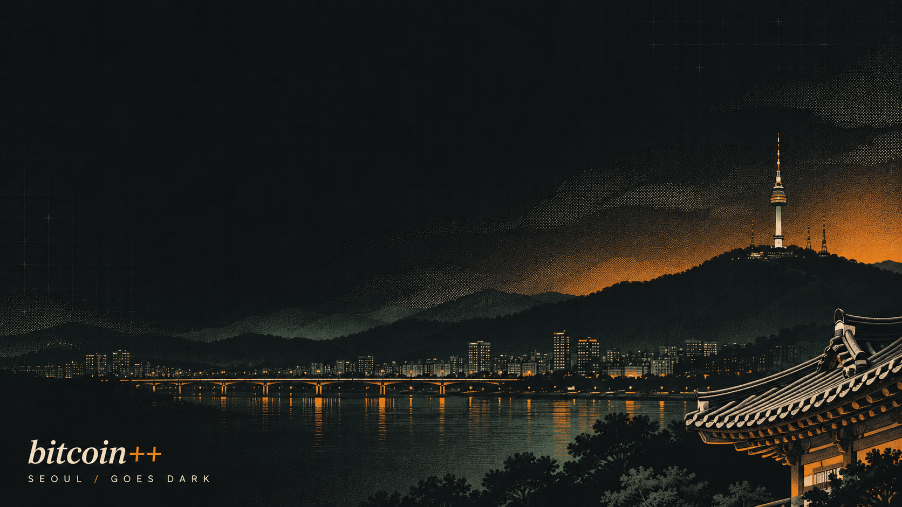

# Seoul Goes Dark

A dark Omarchy theme inspired by [bitcoin++ Seoul](https://btcpp.dev/seoul)
and its privacy edition. Charcoal surfaces, ivory text, Bitcoin amber and
muted jade, with Seoul's skyline and N Seoul Tower above the Han River.



## Install

```bash
omarchy theme install https://github.com/murdawkmedia/omarchy-seoul-goes-dark-theme
```

Built for Omarchy's `colors.toml` theming system. Omarchy generates the
application configurations from the palette, including amber-to-jade active
window borders.

## Wallpapers

- `backgrounds/seoul-goes-dark-16x10.png`: 1440 × 900, fitted for 16:10 displays.
- `backgrounds/seoul-goes-dark.png`: original 1672 × 941 artwork.

Cycle between them with `omarchy theme bg next`.

## License

Released under the MIT license. This is an unofficial community theme;
bitcoin++ and Omarchy names remain those of their respective owners.
